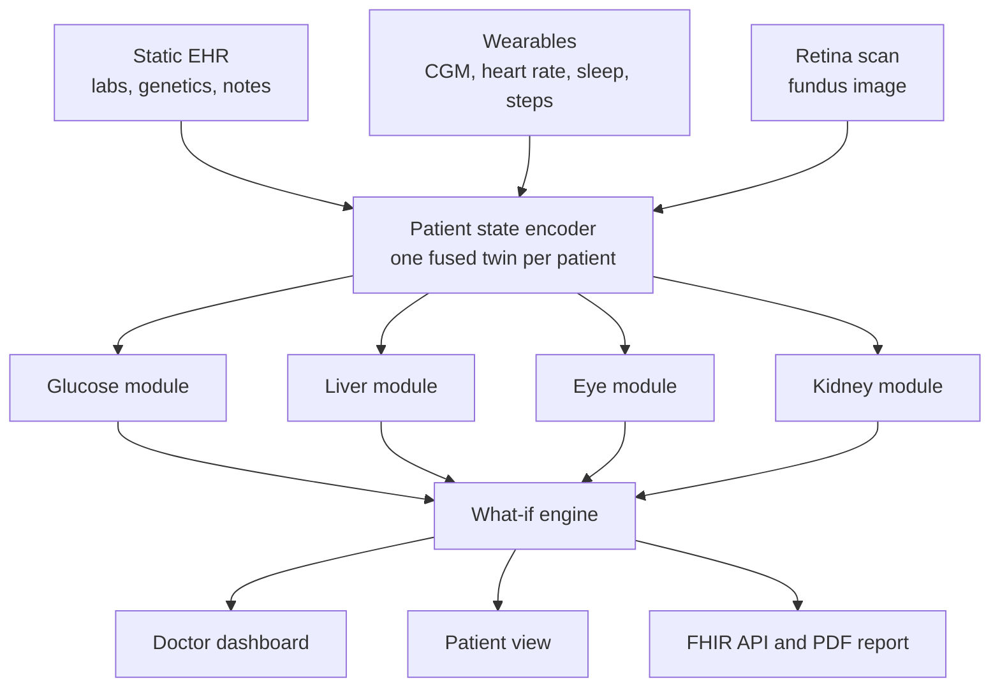

# Kaya

### A multi-organ digital twin for Type 2 Diabetes

> Other digital twins forecast glucose. **Kaya shows what glucose does to the liver, eyes and kidneys**, and lets a doctor test a change on the virtual patient before trying it on the real one.

*Submission to the Happiest Health "Reimagining and Reforming Healthcare in India" Summit 2026, Digital Twin Challenge, Phase 1.*


---

## Team

| | |
|---|---|
| **Team / product** | Kaya |
| **Members** | Dulari Bhushan, Prateek Giddaplavar |
| **Institution** | Indian Institute of Technology Hyderabad (IIT Hyderabad) |

---

## 1. The problem

India has over 100 million people with diabetes. The disease is rarely fatal on its own. The damage comes from **complications that build silently for years**: fatty liver progressing to fibrosis, retinopathy that is found only after vision is lost, and declining kidney function.

Today a patient's glucose is tracked, but their organs are checked once a year, if at all. Existing diabetes "digital twins" and apps focus on **managing sugar**: forecasting spikes, coaching diet, and lowering HbA1c. None of the products we reviewed connects the continuous glucose signal to the **organ damage it causes**, and none lets a doctor ask *"what happens to this patient's liver and eyes if we change X?"*

## 2. What Kaya does

Kaya builds a living virtual replica of a patient by fusing two data streams:

| Stream | Examples |
|---|---|
| **Static / historical** (EHR) | Demographics, diagnoses, lab results, genetic markers (PNPLA3, TCF7L2), clinical notes |
| **Dynamic / real time** (wearables) | Continuous glucose, heart rate, HRV, sleep stages, steps, meals |

From that twin, four modules answer four clinical questions:

| Module | The question it answers | What the doctor gets |
|---|---|---|
| **Glucose** | What will glucose do in the next 2 hours, and is an event coming? | 30 / 60 / 120 minute forecast with an 80% interval; calibrated hypo- and hyperglycemia alerts with lead time |
| **Liver** | Is the liver carrying a heavy metabolic load, and is fibrosis developing? | Steatosis and advanced-fibrosis risk; a rolling liver-fat state driven by recent glucose |
| **Eye** | What is the retinopathy grade, and where is it heading? | DR grade with an explanation heatmap, a 2-year progression risk, and an illustrative preview image |
| **Kidney** | Is kidney function declining, and how fast? | Albuminuria and reduced-eGFR risk, plus a 5-year eGFR path |

On top sits the **what-if engine**: change a meal, add a walk, improve sleep or alter a medication, and Kaya re-runs the twin to show the change in the glucose curve and in one-year organ risk.

## 3. Who uses it and what they see

| User | Goal | What they see |
|---|---|---|
| **Doctor / diabetologist** | Spot who needs attention today, understand why, and choose an intervention | A **triaged patient list** sorted by risk. For each patient: the glucose forecast with its uncertainty band, organ-risk panels (liver, eye, kidney) with trends, an alert timeline with the reason each alert fired, the **what-if panel**, and a one-click **PDF clinical summary** |
| **Patient** | Know what to do next and why it matters | A plain-language view in **English, Hindi, Telugu and Kannada**: today's glucose outlook, a simple nudge ("a 15-minute walk after dinner keeps tonight's spike down"), and a visual of how habits affect their liver and eyes |
| **Clinic administrator** | Run the service safely and responsibly | Consent records, an access audit log, and a **model-health page** showing performance and drift |
| **Hospital IT / integrator** | Plug Kaya into existing systems | A versioned REST API that speaks **FHIR R4** (Patient, Observation, Condition, DiagnosticReport) |

## Screenshots

**Doctor workspace** (with **Go live** and **Download clinical summary**): triaged patients, the glucose twin with a forecast fan you can replay, organ cards, and the what-if studio.


**Patient app**: a plain-language phone view with today's habits, weekly time in range, and a "try a change" simulator.

<p>
  
  
  
</p>

## 4. How it works



## Product features

| Feature | What it does |
|---|---|
| **Live mode** | The glucose model runs on every incoming 5-minute reading (about 1 ms, pure numpy, no GPU) and the dashboard updates in real time. Press **Go live** in the doctor view, or POST readings from a device to `/api/live/{id}/reading`. A WebSocket feed (`/ws/live/{id}`) simulates a wearable. |
| **Explanations** | Why an alert fired (glucose trend and recent meal), what drives each liver and kidney risk for this patient (SHAP), and where the retina model looked (Grad-CAM). |
| **Clinical summary PDF** | One click from the doctor view (`/api/patients/{id}/report.pdf`): glucose chart with forecast, organ risks with their evidence level, what-if table and recent alerts. |
| **Four languages** | The patient app in English, Hindi, Telugu and Kannada with a one-tap switcher. The Indian-language texts are drafts and should be reviewed by a native speaker. |
| **Tests and CI** | 15 tests (data, what-if, live inference against PyTorch, API, PDF, FHIR) run on every push with GitHub Actions. |

## 5. Results so far

All numbers below are **out-of-sample**: held-out patients for the synthetic cohort, and subject-level cross-validation on real data.

### Glucose forecasting (real CGMacros recordings, 34 subjects)

| Model | RMSE 30 / 60 / 120 min (mg/dL) | 80% interval coverage |
|---|---|---|
| No change (persistence) | 16.3 / 25.8 / 36.7 | n/a |
| GRU fine-tuned | 13.7 / 21.7 / 28.7 | 0.79 / 0.78 / 0.77 |
| LightGBM | 12.4 / 21.6 / 29.3 | 0.72 / 0.68 / 0.62 |
| **Ensemble, calibrated** | **12.6 / 21.1 / 28.2** | **0.80 / 0.80 / 0.80** |

- Intervals are **conformal**, so the stated 80% really is 80%.
- Event probabilities are **isotonic-calibrated** (expected calibration error 0.003 to 0.005).
- **Alert replay** (a patient's week streamed through the model): at about one false alert per patient-day, Kaya catches **72% of hypoglycemia episodes with a median 45 minutes of warning**.

### Liver (real NHANES 2017-2018, 4,745 adults, FibroScan-labelled)

| Target | Kaya (AUROC) | Standard score |
|---|---|---|
| Advanced fibrosis (stiffness ≥ 8 kPa) | **0.83** | FIB-4: 0.63 |
| Steatosis (CAP ≥ 288 dB) | **0.83** | FLI: 0.82, HSI: 0.79 |

Performance is similar in adults with diabetes (0.76 steatosis, 0.80 fibrosis) and in Asian participants. Full numbers with confidence intervals are in [`results/`](results/).

### Kidney (real NHANES 2017-2018, 4,827 adults)

| Target | Kaya (AUROC) | Simple baseline (age, BP, HbA1c, diabetes) |
|---|---|---|
| Reduced eGFR (< 60) | 0.85 | 0.85 |
| Albuminuria (UACR >= 30) | 0.76 | 0.75 |
| Any CKD | 0.79 | 0.78 |

Honest reading: from routine measurements the learned model adds only a small edge over a strong simple baseline. The product value is the eGFR trajectory and what-if, which are labelled simulations.

### Eye (retinopathy grading from fundus photos)

EfficientNet-B2, ordinal regression, trained on APTOS 2019 and tested on the Indian IDRiD dataset.

| Evaluation | Quadratic kappa | Referable DR AUROC | Within one grade |
|---|---|---|---|
| APTOS 2019, held-out 15% | 0.89 | 0.98 | 96% |
| IDRiD test (Indian), no fine-tuning | 0.57 | 0.88 | 83% |
| IDRiD test (Indian), after fine-tuning on IDRiD train | 0.71 | 0.92 | 87% |

The drop on IDRiD without fine-tuning is expected camera and population shift; a small amount of local data closes part of the gap. Exact-grade accuracy on IDRiD is 43% after fine-tuning, so Kaya reports grades as decision support alongside Grad-CAM heatmaps. Retinopathy *progression* risk is a simulation with editable assumptions.

## 6. Data

Only open or synthetic data is used, as required by the challenge and the DPDP Act.

| Need | Source | Status |
|---|---|---|
| CGM, meals, wearables | [CGMacros](https://physionet.org/content/cgmacros/1.0.0/) (PhysioNet) | Used |
| Liver labels | NHANES 2017-2018 (FibroScan, labs) | Used |
| Synthetic patients and streams | Our generator (`src/ingest/synthetic_cohort.py`), plus simglucose | Used |
| Retina images | APTOS 2019 (train), IDRiD (Indian test) | Used |
| Synthetic EHR | Synthea | Planned |

### An honest note on the synthetic cohort

No public dataset links one person's glucose stream to their liver, eye and kidney outcomes. We therefore simulate a **bridged cohort** whose distributions follow Indian T2D epidemiology and whose organ outcomes follow documented risk relationships. We state clearly what this means:

- **Every module is validated on real data wherever real data exists** (glucose on CGMacros, liver on NHANES).
- The synthetic cohort demonstrates that the **data fusion and the mechanisms work end to end**. It does not establish clinical accuracy of the links between glucose patterns and organ outcomes.
- Kaya is **decision support for clinicians, not a diagnostic device**, and has not been clinically validated.

## 7. Technical stack

| Layer | Tools |
|---|---|
| Models | PyTorch (GRU with quantile and event heads), LightGBM, scikit-learn, SHAP |
| Uncertainty | Conformal prediction, isotonic calibration |
| Data | pandas, pyarrow, wfdb, simglucose |
| Vision | timm (EfficientNet), Grad-CAM |
| Backend | FastAPI, Pydantic, FHIR R4 resources |
| Frontend | React |
| Delivery | Docker Compose, GitHub Actions |
| Compute | 3 × NVIDIA RTX A5000 |

## 8. Design principles

- **Privacy by design:** synthetic or anonymized data only, consent records, minimal data, access audit log.
- **Explainable:** every prediction can show why it fired, and how sure the model is.
- **Interoperable:** FHIR R4 in and out, designed to align with India's ABDM.
- **Honest:** metrics reported with confidence intervals and against standard baselines; limitations stated up front.

## 9. Project status

| Component | Status |
|---|---|
| Data pipelines and synthetic cohort | Built |
| Glucose forecaster, alerts, calibration | Built |
| Static liver model | Built |
| Dynamic liver state | Built |
| Kidney module (risk and eGFR path) | Built |
| What-if engine | Built |
| REST API with FHIR read endpoints | Built |
| Web dashboard: doctor workspace, patient view, replay | Built |
| Eye module (retinopathy grader, Grad-CAM, progression risk) | Built |
| Illustrative retina preview | Planned |

**Version 1 ships the glucose, liver, eye and kidney modules, the what-if engine, the API and the doctor and patient views (English).** The following are on the roadmap for later versions and are not claimed as built: illustrative retina preview, PDF clinical summary, Hindi/Telugu/Kannada patient view, model-health page, authentication and audit log, fuller FHIR and ABDM coverage.

See [`docs/PROJECT_PLAN.md`](docs/PROJECT_PLAN.md) for the detailed plan and backlog.

## 10. Repository layout

```
.
├── src/
│   ├── ingest/      synthetic cohort, NHANES liver dataset
│   └── models/      window builders, glucose models, alerts, liver model
├── scripts/         data download and server setup
├── results/         evaluation metrics (JSON)
├── docs/            project plan, architecture, presentation
├── tests/           unit tests
└── requirements.txt
```

## 11. Reproducing the results

```bash
pip install -r requirements.txt
python scripts/fetch_data.py all                 # CGMacros + NHANES
python src/ingest/synthetic_cohort.py --n 2000 --days 14
python src/ingest/nhanes_liver.py
PYTHONPATH=src/models python src/models/train_glucose.py
PYTHONPATH=src/models python src/models/polish_glucose.py
python src/models/liver_static.py
```

## 12. Run the demo

The demo runs from a plain clone, with no GPU. Forecasts and risk scores for 24 held-out synthetic patients are precomputed by the validated models and stored in `artifacts/demo/`.

```bash
pip install -r requirements-api.txt
uvicorn app:app --app-dir src/api --port 8000
# open http://localhost:8000          (dashboard)
# open http://localhost:8000/docs     (API documentation)
```

Or with Docker: `docker compose up --build`.

In the dashboard, switch between **Doctor** and **Patient** at the top right. In the doctor view, press **Replay last 3 days** to watch the twin forecast glucose ahead of what actually happens, then try the **What-if** presets to see the change in glucose and organ risk.

To regenerate the artifacts from the models (needs the trained weights): `PYTHONPATH=src/models:src/whatif python src/api/build_artifacts.py`.

## 13. Demo and documents

| Item | Link |
|---|---|
| Demo video (20+ min) | _to be added_ |
| Architecture diagram (PDF) | _to be added_ |
| Presentation (PDF) | _to be added_ |

## 14. License

Released under the [Apache License 2.0](LICENSE).
