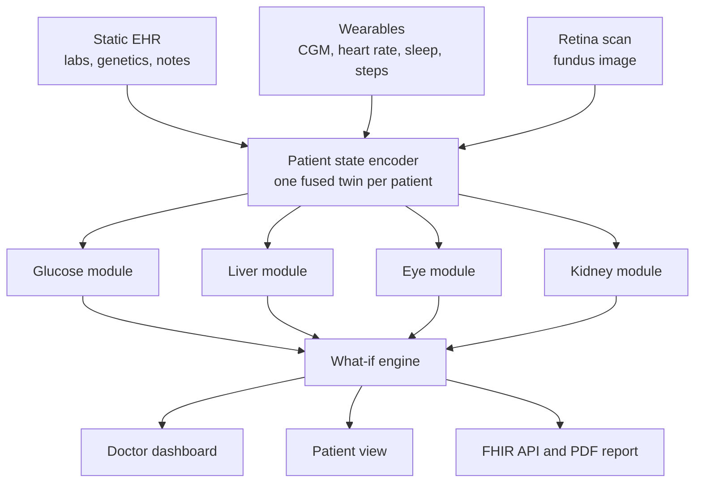

# Kaya

### A Multi-Organ Digital Twin for Type 2 Diabetes

> Other digital twins forecast glucose. **Kaya shows what glucose does to the liver, eyes and kidneys**, and lets a doctor test a change on the virtual patient before trying it on the real one.

*Submission to the Happiest Health "Reimagining and Reforming Healthcare in India" Summit 2026, Digital Twin Challenge, Phase 1.*


---

## Submission at a glance

| Required item | Where it is |
|---|---|
| Team details | [Team](#team) |
| College / incubator information | [Team](#team) |
| Project title | Above: **Kaya, A Multi-Organ Digital Twin for Type 2 Diabetes** |
| Problem statement | [1. The problem](#1-the-problem) |
| Healthcare use case | [2. Healthcare use case](#2-healthcare-use-case) |
| Technical stack | [7. Technical stack](#7-technical-stack) |
| AI/ML model or framework details | [6. AI/ML models and results](#6-aiml-models-and-results) and [`MODEL_CARDS.md`](Kaya_IIT-Hyderabad/docs/MODEL_CARDS.md) |
| Demo video (unlisted YouTube) | [12. Demo video and documents](#12-demo-video-and-documents) |
| Open-source license | [14. License](#14-license), file [`LICENSE`](Kaya_IIT-Hyderabad/LICENSE) |
| Architecture diagram (PDF) | [`architecture_2page.pdf`](Kaya_IIT-Hyderabad/docs/architecture_2page.pdf) |
| Presentation (PDF / PPT) | [`Kaya_presentation.pdf`](Kaya_IIT-Hyderabad/docs/Kaya_presentation.pdf), [`Kaya_pitch_deck.pptx`](Kaya_IIT-Hyderabad/docs/Kaya_pitch_deck.pptx) |

---

## Team

| | |
|---|---|
| **Team / product** | Kaya |
| **Members** | Dulari Bhushan, Prateek Giddaplavar |
| **College** | Indian Institute of Technology Hyderabad (IIT Hyderabad) |
| **Incubator** | None; this is a student team project |

---

## What is new in Kaya

| | Novelty | Why it matters |
|---|---|---|
| 1 | **One twin for four organs, not one signal.** The continuous glucose stream feeds a liver, an eye and a kidney module, so the twin shows the organ damage that glucose causes, not just the next spike. | Diabetes harms the organs silently for years; today they are checked once a year, if at all. To our knowledge, no other diabetes twin we reviewed links glucose to organ outcomes. |
| 2 | **A what-if engine that reaches the organs.** Change a meal, add a walk, improve sleep or alter a medicine, and Kaya re-runs the twin and shows the change in the glucose curve *and* in one-year liver, eye and kidney risk. | A doctor can test a plan on the virtual patient first. Outputs are labelled simulations with editable assumptions. |
| 3 | **Every module is validated on real data, and benchmarked against the standard score.** Liver against FIB-4, FLI and HSI on 4,745 NHANES adults; glucose on real CGMacros recordings; retinopathy on the Indian IDRiD set. | Honest numbers with baselines. Where the model adds little (kidney), we say so. |
| 4 | **Trustworthy uncertainty.** Conformal 80% intervals that really cover 80%, and isotonic-calibrated event probabilities (expected calibration error 0.003 to 0.005). | A forecast is only useful if the doctor knows how sure it is. |
| 5 | **Real-time on a laptop.** The glucose model runs on every 5-minute reading in about 1 ms in pure numpy, with no GPU, so live mode works anywhere. | Deployable in a small clinic. |
| 6 | **Explainable by design.** Every alert shows why it fired; SHAP shows what drives each liver and kidney risk; Grad-CAM shows where the retina model looked. | Doctors can check the reasoning instead of trusting a number. |
| 7 | **Built for India.** The retina grader is fine-tuned and tested on Indian IDRiD images; the patient app runs in English, Hindi, Telugu and Kannada with voice (Sarvam AI); lab reports are read in Indian layouts (SGPT/SGOT, lakh/cumm); FHIR R4 endpoints for ABDM-aware integration. | Reach beyond English-speaking, urban users. |
| 8 | **A safe assistant, with the rules in code.** Emergency words get a fixed "call 108" reply; medicine and dose questions are sent to the doctor; any model reply containing dose advice is replaced. These checks run in code, before and after the language model. | Safety does not depend on the model behaving well. |
| 9 | **Patient reports are never read without a yes.** A patient can upload a PDF or photo of a report. The AI reads it only after the patient agrees, shows a summary, and the doctor sees every upload marked "not verified". The parser is rule-based, so every number traces to a line of the document. | Consent and traceability, with nothing invented. |
| 10 | **Run like a product.** Admin page with health, model inventory, latency, audit trail and a one-click self-test; tests and CI; Docker Compose; honest model cards. | Reviewers can see what runs and how it was checked. |

---

## 1. The problem

India has over 100 million people with diabetes. The disease is rarely fatal on its own. The damage comes from **complications that build silently for years**: fatty liver progressing to fibrosis, retinopathy that is found only after vision is lost, and declining kidney function.

Today a patient's glucose is tracked, but their organs are checked once a year, if at all. Existing diabetes "digital twins" and apps focus on **managing sugar**: forecasting spikes, coaching diet and lowering HbA1c. None of the products we reviewed connects the continuous glucose signal to the **organ damage it causes**, and none lets a doctor ask *"what happens to this patient's liver and eyes if we change X?"*

## 2. Healthcare use case

**Routine follow-up of Indian adults with Type 2 Diabetes.** These patients are often lean but carry fatty liver, eat a carbohydrate-heavy diet, and have a high burden of silent fatty liver disease and retinopathy that is usually found late.

Kaya builds a living virtual replica of each patient by fusing two data streams:

| Stream | Examples |
|---|---|
| **Static / historical** (EHR) | Demographics, diagnoses, lab results, genetic markers (PNPLA3, TCF7L2), clinical notes |
| **Dynamic / real time** (wearables) | Continuous glucose, heart rate, HRV, sleep stages, steps, meals |

From that twin, four modules answer four clinical questions:

| Module | The question it answers | What the doctor gets |
|---|---|---|
| **Glucose** | What will glucose do in the next 2 hours, and is an event coming? | 30 / 60 / 120 minute forecast with an 80% interval; calibrated hypo- and hyperglycemia alerts with lead time |
| **Liver** | Is the liver carrying a heavy metabolic load, and is fibrosis developing? | Steatosis and advanced-fibrosis risk; a rolling liver-fat state driven by recent glucose |
| **Eye** | What is the retinopathy grade, and where is it heading? | DR grade with an explanation heatmap and a 2-year progression risk |
| **Kidney** | Is kidney function declining, and how fast? | Albuminuria and reduced-eGFR risk, plus a 5-year eGFR path |

On top sits the **what-if engine**, described above.

### Who uses it

| User | Goal | What they see |
|---|---|---|
| **Doctor / diabetologist** | Spot who needs attention today, understand why, and choose an intervention | A triaged patient list sorted by risk. For each patient: the glucose forecast with its uncertainty band, organ-risk panels with trends, an alert timeline with the reason each alert fired, the what-if panel, a what-changed-since-last-visit card and a one-click PDF clinical summary |
| **Patient** | Know what to do next and why it matters | A plain-language phone view in English, Hindi, Telugu and Kannada: one clear next action, today's glucose outlook, and how habits affect their liver and eyes |
| **Clinic administrator / IT** | Run the service safely and responsibly | An admin page with service health, model inventory, traffic, audit trail and a self-test |
| **Hospital IT / integrator** | Plug Kaya into existing systems | A versioned REST API with FHIR R4 read endpoints (Patient, Observation) |

## 3. Screenshots

**Doctor record.** Click any patient for the full record: glucose history, organ projections with their drivers, labs, alerts and reports.

<p>
  
  
  
</p>
<p>
  
  
  
</p>

**Patient app.** A plain-language phone view with today's habits, weekly time in range and a "try a change" simulator.

<p>
  
  
  
  
</p>

**Four languages.**

<p>
  
  
  
</p>

**Reports and operations.**

<p>
  
  
  
</p>

## 4. How it works



The full diagrams are in [`architecture_2page.pdf`](Kaya_IIT-Hyderabad/docs/architecture_2page.pdf) (page 1: overview, page 2: detail). Source: [`make_flow_simple.py`](Kaya_IIT-Hyderabad/docs/make_flow_simple.py).

## 5. Product features

| Feature | What it does |
|---|---|
| **Live mode** | The glucose model runs on every incoming 5-minute reading (about 1 ms, pure numpy, no GPU) and the dashboard updates in real time. Press **Go live** in the doctor view, or POST readings to `/api/live/{id}/reading`. A WebSocket feed (`/ws/live/{id}`) simulates a wearable. |
| **Full patient record** | 14-day glucose history, daily time in range, a typical-day profile, meal responses, wearable trends, liver, eye and kidney projections with their drivers, labs with reference flags, and every alert with its reason. |
| **What-if studio** | Meal size, walking after meals, sleep and medicine presets, with the change shown in the glucose curve and in one-year organ risk. |
| **Medical reports** | Lab panels, retinal and liver scans, chest X-ray, ECG, foot exam, clinic notes and the wearable summary, each with reference ranges, flags, the previous value, a PDF and trends. The patient sees a plain-language version and a medicine list. All reports are synthetic. |
| **What changed since the last visit** | Compares today with the last clinic visit (HbA1c, eGFR, urine albumin, liver enzymes, blood pressure, weight, eye grade, new medicines) and the last 7 days of wearable data with the week before, and lists what needs attention. |
| **What to do now and quick log** | The patient's Today screen leads with one clear next action and why. A quick log takes five seconds (medicines, a walk, how they feel). The doctor sees an adherence grid in the record. |
| **Patient report uploads** | A patient uploads a PDF or photo of a report (up to 8 MB). Files are checked by content and stored under random ids. The AI reads a report only after the patient says yes, shows a summary, and the doctor sees the file marked "uploaded by the patient, not verified". |
| **Voice and chat assistant (optional)** | A microphone icon opens an assistant: ask by voice or text in your own language, hear any answer or the current screen read aloud, navigate by voice, switch on large text (A+). Uses [Sarvam AI](https://docs.sarvam.ai) from the server, so the key never reaches the browser. Works without a key too (rules, navigation, browser speech). |
| **Four languages** | English, Hindi, Telugu and Kannada with a one-tap switcher. The Indian-language texts are drafts and should be reviewed by a native speaker. |
| **Explanations** | Why an alert fired (trend and recent meal), what drives each liver and kidney risk (SHAP), and where the retina model looked (Grad-CAM). |
| **Clinical summary PDF** | One click from the doctor view (`/api/patients/{id}/report.pdf`): glucose chart with forecast, organ risks with their evidence level, what-if table and recent alerts. |
| **Admin page** | Service health, model and data inventory with how each model was validated, integration status, latency per route, assistant safety counters (outcomes only, never message text), an audit trail, a one-click self-test and an honest hardening list. Set `KAYA_ADMIN_TOKEN` to require a token. |
| **FHIR R4** | Read-only `Patient` and `Observation` endpoints under `/fhir`. |
| **Tests and CI** | 84 tests (data, what-if, live inference against PyTorch, API, assistant safety, uploads, PDF, FHIR) run on every push with GitHub Actions. |

## 6. AI/ML models and results

All numbers are **out-of-sample**: held-out patients for the synthetic cohort, and subject-level cross-validation on real data. Full details, limits and intended use are in [`MODEL_CARDS.md`](Kaya_IIT-Hyderabad/docs/MODEL_CARDS.md); raw metrics are in [`results/`](Kaya_IIT-Hyderabad/results/).

| Module | Model | Trained / validated on |
|---|---|---|
| Glucose forecast and alerts | GRU with quantile and event heads, blended with LightGBM; conformal intervals; isotonic calibration | Synthetic cohort (2,000 patients), then fine-tuned on real CGMacros (34 subjects) |
| Liver (static) | Regularised LightGBM with SHAP | NHANES 2017-2018, 4,745 adults with FibroScan |
| Liver (dynamic) | Glycemic-load modifier on the log-odds with a 90-day lag | Literature-informed assumptions, shown as a simulation |
| Kidney | Regularised LightGBM with SHAP; CKD-EPI 2021 eGFR; linear eGFR path | NHANES 2017-2018, 4,827 adults |
| Eye | EfficientNet-B2, ordinal regression, Grad-CAM | Trained on APTOS 2019, tested on Indian IDRiD |
| What-if | Splits glucose into baseline and meal excursions, rescales them, feeds the liver and eye modules | Literature-informed effect sizes, labelled as a simulation |
| Assistant | Sarvam AI (speech to text, text to speech, chat) behind rule-based safety | Rules tested in four languages |

### Glucose forecasting (real CGMacros recordings, 34 subjects)

| Model | RMSE 30 / 60 / 120 min (mg/dL) | 80% interval coverage |
|---|---|---|
| No change (persistence) | 16.3 / 25.8 / 36.7 | n/a |
| GRU fine-tuned | 13.7 / 21.7 / 28.7 | 0.79 / 0.78 / 0.77 |
| LightGBM | 12.4 / 21.6 / 29.3 | 0.72 / 0.68 / 0.62 |
| **Ensemble, calibrated** | **12.6 / 21.1 / 28.2** | **0.80 / 0.80 / 0.80** |

- Intervals are **conformal**, so the stated 80% really is 80%.
- Event probabilities are **isotonic-calibrated** (expected calibration error 0.003 to 0.005).
- **Alert replay** (a patient's week streamed through the model): at about one false alert per patient-day, Kaya catches **72% of hypoglycemia episodes with a median 45 minutes of warning**.

### Liver (real NHANES 2017-2018, 4,745 adults, FibroScan-labelled)

| Target | Kaya (AUROC) | Standard score |
|---|---|---|
| Advanced fibrosis (stiffness ≥ 8 kPa) | **0.83** | FIB-4: 0.63 |
| Steatosis (CAP ≥ 288 dB) | **0.83** | FLI: 0.82, HSI: 0.79 |

Performance is similar in adults with diabetes (0.76 steatosis, 0.80 fibrosis) and in Asian participants.

### Kidney (real NHANES 2017-2018, 4,827 adults)

| Target | Kaya (AUROC) | Simple baseline (age, BP, HbA1c, diabetes) |
|---|---|---|
| Reduced eGFR (< 60) | 0.85 | 0.85 |
| Albuminuria (UACR ≥ 30) | 0.76 | 0.75 |
| Any CKD | 0.79 | 0.78 |

Honest reading: from routine measurements the learned model adds only a small edge over a strong simple baseline. The product value is the eGFR trajectory and what-if, which are labelled simulations.

### Eye (retinopathy grading from fundus photos)

| Evaluation | Quadratic kappa | Referable DR AUROC | Within one grade |
|---|---|---|---|
| APTOS 2019, held-out 15% | 0.89 | 0.98 | 96% |
| IDRiD test (Indian), no fine-tuning | 0.57 | 0.88 | 83% |
| IDRiD test (Indian), after fine-tuning on IDRiD train | 0.71 | 0.92 | 87% |

The drop on IDRiD without fine-tuning is expected camera and population shift; a small amount of local data closes part of the gap. Exact-grade accuracy on IDRiD is 43% after fine-tuning, so Kaya reports grades as decision support alongside Grad-CAM heatmaps. Retinopathy *progression* risk is a simulation with editable assumptions.

## 7. Technical stack

| Layer | Tools |
|---|---|
| Models | PyTorch (GRU with quantile and event heads), LightGBM, scikit-learn, SHAP |
| Uncertainty | Conformal prediction, isotonic calibration |
| Data | pandas, pyarrow, wfdb, simglucose |
| Vision | timm (EfficientNet-B2), Grad-CAM |
| Live inference | NumPy export of the GRU (verified against PyTorch to within 1e-3) |
| Backend | FastAPI, Pydantic, FHIR R4 resources, WebSockets, ReportLab (PDF) |
| Frontend | React, Vite |
| Voice and language | Sarvam AI (speech to text, text to speech, chat), browser speech as fallback |
| Delivery | Docker Compose, GitHub Actions |
| Compute | 3 × NVIDIA RTX A5000 for training; the demo needs no GPU |

## 8. Data

Only open or synthetic data is used, as required by the challenge and the DPDP Act.

| Need | Source | Status |
|---|---|---|
| CGM, meals, wearables | [CGMacros](https://physionet.org/content/cgmacros/1.0.0/) (PhysioNet) | Used |
| Liver and kidney labels | NHANES 2017-2018 (FibroScan, labs) | Used |
| Synthetic patients and streams | Our generator (`src/ingest/synthetic_cohort.py`), plus simglucose | Used |
| Retina images | APTOS 2019 (train), IDRiD (Indian test, CC BY 4.0) | Used |
| Synthetic EHR | Synthea | Planned |

### An honest note on the synthetic cohort

No public dataset links one person's glucose stream to their liver, eye and kidney outcomes. We therefore simulate a **bridged cohort** whose distributions follow Indian T2D epidemiology and whose organ outcomes follow documented risk relationships:

- **Every module is validated on real data wherever real data exists** (glucose on CGMacros, liver and kidney on NHANES, eye on APTOS and IDRiD).
- The synthetic cohort demonstrates that the **data fusion and the mechanisms work end to end**. It does not establish clinical accuracy of the links between glucose patterns and organ outcomes.
- Kaya is **decision support for clinicians, not a diagnostic device**, and has not been clinically validated.

## 9. Design principles

- **Privacy by design:** synthetic or anonymised data only, consent before AI reads an upload, minimal data, audit log, message text never stored.
- **Explainable:** every prediction can show why it fired and how sure the model is.
- **Interoperable:** FHIR R4, designed to align with India's ABDM.
- **Honest:** metrics reported against standard baselines, simulations labelled as simulations, limitations stated up front.

## 10. Run the demo

The demo runs from a plain clone, with no GPU. Forecasts and risk scores for 24 held-out synthetic patients are precomputed by the validated models and stored in `artifacts/demo/`.

**With Docker**

```bash
cd Kaya_IIT-Hyderabad
docker compose up --build
```

**Without Docker**

```bash
cd Kaya_IIT-Hyderabad
pip install -r requirements-api.txt
uvicorn app:app --app-dir src/api --port 8000
```

Then open `http://localhost:8000` (dashboard) and `http://localhost:8000/docs` (API documentation).

In the dashboard, switch between **Doctor**, **Patient** and **Admin** at the top right. In the doctor view, press **Replay last 3 days** to watch the twin forecast glucose ahead of what actually happens, then try the **What-if** presets. [`DEMO_GUIDE.md`](Kaya_IIT-Hyderabad/docs/DEMO_GUIDE.md) describes two ready-made patients (a complex multi-organ case and a well-controlled case), their day-by-day stories and a suggested demo flow.

**Voice assistant (optional).** Copy `.env.example` to `.env` and set `SARVAM_API_KEY`. Without a key the rest of the app works unchanged.

**Tests**

```bash
cd Kaya_IIT-Hyderabad
pip install pytest httpx
python -m pytest -q tests
```

**Reproduce the model results** (needs the data downloads and, for training, a GPU)

```bash
pip install -r requirements.txt
python scripts/fetch_data.py all                 # CGMacros + NHANES
python src/ingest/synthetic_cohort.py --n 2000 --days 14
python src/ingest/nhanes_liver.py
PYTHONPATH=src/models python src/models/train_glucose.py
PYTHONPATH=src/models python src/models/polish_glucose.py
python src/models/liver_static.py
```

To regenerate the demo artifacts from the trained models: `PYTHONPATH=src/models:src/whatif python src/api/build_artifacts.py`.

## 11. Repository layout

```
Kaya_IIT-Hyderabad/
├── src/
│   ├── api/         FastAPI app, FHIR, reports, uploads, assistant, admin
│   ├── ingest/      synthetic cohort, NHANES datasets, demo patient stories
│   ├── models/      glucose, liver, kidney, eye models and alerts
│   └── whatif/      what-if engine
├── dashboard/       React doctor, patient and admin views
├── artifacts/       precomputed demo patients, live model, retina images
├── results/         evaluation metrics (JSON)
├── docs/            architecture, presentation, model cards, demo guide, screenshots
├── scripts/         data download and server setup
├── tests/           84 tests
├── Dockerfile, docker-compose.yml
└── requirements.txt, requirements-api.txt
```

## 12. Demo video and documents

| Item | Link |
|---|---|
| Demo video (unlisted YouTube) | [Watch on YouTube](https://youtu.be/SyA4dCjmQi8) |
| Architecture diagram (PDF) | [`architecture_2page.pdf`](Kaya_IIT-Hyderabad/docs/architecture_2page.pdf) |
| Presentation (PDF) | [`Kaya_presentation.pdf`](Kaya_IIT-Hyderabad/docs/Kaya_presentation.pdf) |
| Presentation (PPT) | [`Kaya_pitch_deck.pptx`](Kaya_IIT-Hyderabad/docs/Kaya_pitch_deck.pptx) |
| Model cards | [`MODEL_CARDS.md`](Kaya_IIT-Hyderabad/docs/MODEL_CARDS.md) |
| Demo guide | [`DEMO_GUIDE.md`](Kaya_IIT-Hyderabad/docs/DEMO_GUIDE.md) |
| Project plan and roadmap | [`PROJECT_PLAN.md`](Kaya_IIT-Hyderabad/docs/PROJECT_PLAN.md) |

## 13. Limitations and roadmap

**Limitations, stated plainly**

- Kaya is decision support, not a diagnostic device, and has not been clinically validated.
- The link from glucose patterns to organ outcomes is simulated; each module's baseline model is validated on real data, but the dynamic effects (liver drift, retinopathy progression, eGFR path, what-if effect sizes) use literature-informed assumptions.
- Only 34 real CGM subjects; NHANES is a US population; exact-grade retinopathy accuracy on IDRiD is modest.
- The Hindi, Telugu and Kannada texts and the speech quality need native-speaker review.
- The demo uses synthetic patients and has no authentication; the admin page lists what must be hardened before real patient data.

**Roadmap:** illustrative retina preview (a generated fundus image at the predicted grade, always labelled as a preview), Synthea-based EHR, authentication and role-based access, fuller FHIR and ABDM coverage, and prospective validation with a clinical partner.

## 14. License

Released under the [Apache License 2.0](Kaya_IIT-Hyderabad/LICENSE).
